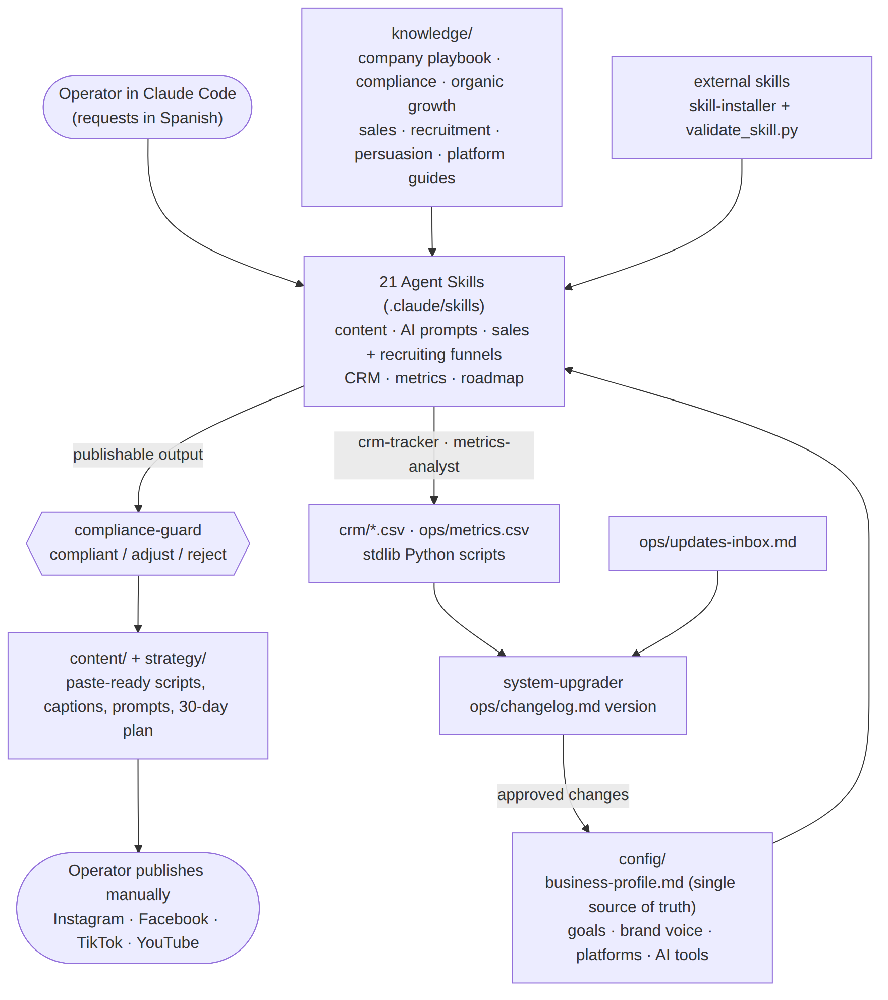
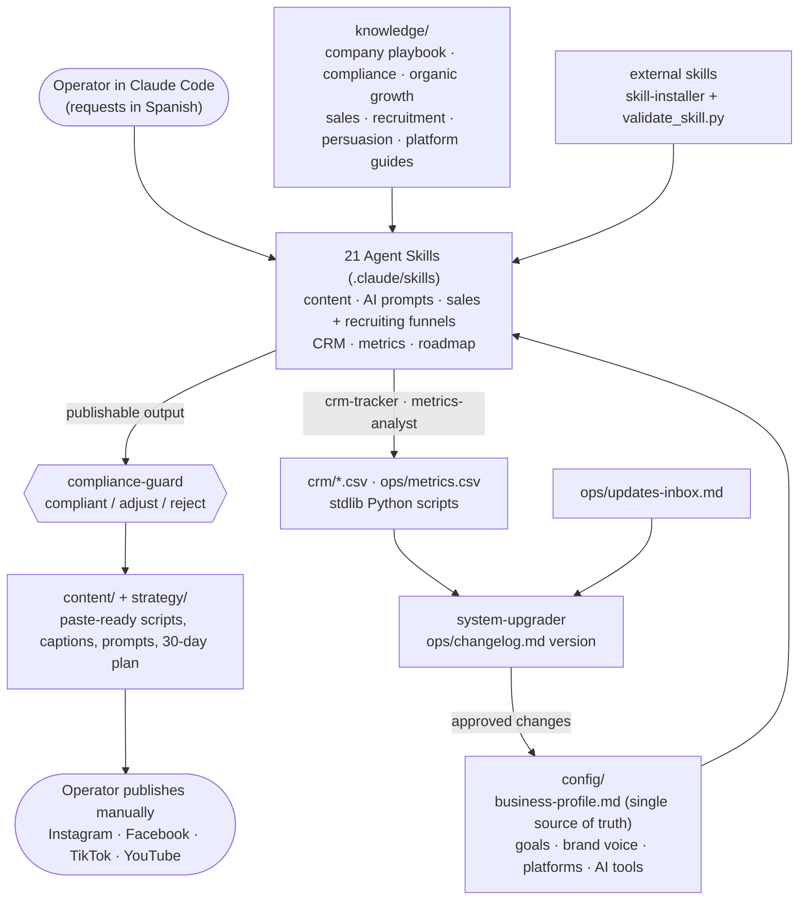

# Direct Sales Growth OS

A Claude Code system for an independent direct-sales beauty consultant: 21 Agent Skills, a set of playbooks and a CSV CRM that turn one business profile into paste-ready Spanish (es-MX) content, sales and recruiting funnels, and a weekly review loop. Every publishable output passes a compliance check.

  

## What it does

An independent consultant in a direct-sales (network-marketing) beauty company needs a steady stream of content on four platforms, conversations that turn into sales and new team members, and a way to track all of it. They also have to stay clear of the two things that get consultants into trouble: income claims and medical claims.

This repository encodes that work as a Claude Code project:
- **Configuration:** one editable business profile, plus playbooks for organic growth, sales, recruiting and compliance.
- **Skills:** 21 Agent Skills produce the day's scripts, captions, AI video/image/voice prompts and DM scripts. Each one hands its output to a `compliance-guard` skill before returning it.
- **Tracking:** small Python scripts keep the CRM, the calendar, the metrics log and the system version.

The operator publishes by hand; nothing is posted automatically. The repository ships with a **fictional example operator** ("Sofía Ejemplo") and no real company data.

## Demo

Everything below is output that ships in the repository (`content/day-01/`, `strategy/`, the skills and their scripts). It was produced for the fictional example profile.

**Day 1 — Instagram Reel (excerpt of `content/day-01/instagram.md`):**

```text
Hook (0–2s, on-screen + VO): "Estás comprando productos para la piel equivocada."
  [lockup: "¿Tu piel o la del anuncio?"]
CTA: "Comenta 'PIEL' y te digo cuál es el tuyo y por dónde empezar."

Caption: Estás cuidando tu piel… ¿pero conoces tu tipo de piel? Grasa, seca, mixta o sensible:
cada una pide una rutina distinta. […] Comenta 'PIEL' y te escribo por DM. 🧴
Hashtags: #skincaremexico #rutinadeskincare #tipodepiel #cuidadodelapiel #cdmx #desmaquillante
Funnel: comentario 'PIEL' → DM (sales-funnel) → WhatsApp → recomendación → oferta de entrada
Mejor horario (CDMX): 12:00–14:00 o 19:00–21:00
```

The same master idea is adapted for TikTok (SEO-first script), a Facebook post, a YouTube Short with metadata, and a prompt sheet for Higgsfield/Veo, ElevenLabs and Premiere (`content/day-01/`).

**`compliance-guard` (example from its skill definition):**

```text
Input:  "Únete y gana $20,000 al mes, ¡ingreso garantizado!"
VEREDICTO: reject
RAZONES:
  - §1 No income claims/guarantees: promete cifra e ingreso garantizado.
VERSIÓN CORREGIDA:
  "Te cuento honestamente cómo funciona la oportunidad y qué esperar. Sin promesas: depende de
   tu esfuerzo y constancia. ¿Te explico sin compromiso?"
```

**CRM and versioning scripts:**

```text
$ python .claude/skills/crm-tracker/scripts/update_crm.py --crm-dir crm add-lead \
    --alias "Prueba" --platform instagram --interest sale --next-step "enviar rutina" --next-date 2026-10-02
Lead agregado: id=1 alias='Prueba' platform=instagram interest=sale stage=nuevo next_step='enviar rutina' (2026-10-02)

$ python .claude/skills/system-upgrader/scripts/bump_version.py --part patch --message "prueba" --dry-run
Versión: v0.5.0 → v0.5.1
```

A 30-day plan (`strategy/content-plan-30d.md`) and its calendar (`strategy/calendar-30d.csv`, produced with `build_calendar.py`) are also included.

## Architecture





- **Configuration.** `config/business-profile.md` holds everything specific to the operator: company, current and target rank, market, handles, WhatsApp link, time budget, 3-layer content ratios, hero product, and a personal `key_differentiator` used in voice and hooks. Skills read it instead of hard-coding facts.
- **Knowledge.** `knowledge/` holds the rules the skills apply:
  - a company-playbook template (ranks and requirements, filled from official sources);
  - compliance rules (no income or medical claims, trademark and contract rules, COFEPRIS/PROFECO, platform ToS, privacy);
  - organic-growth, sales, recruiting and persuasion playbooks;
  - one guide per platform.
- **Skills.** The operator asks in Spanish ("dame el contenido de hoy", "agrega este prospecto", "haz la revisión semanal"), and skill descriptions contain those trigger phrases. The main groups:
  - **Content:** `content-planner`, `script-writer`, `repurpose-engine`, `caption-writer`, `hook-writer`, `carousel-builder`.
  - **AI prompts:** `video-`, `image-` and `voice-prompt-studio`, plus `persona-designer`.
  - **Funnels:** `sales-funnel`, `offer-writer`, `recruitment-funnel`, `lead-magnet-builder`.
- **Compliance gate.** Every skill that produces publishable text invokes `compliance-guard`. It returns a verdict (compliant, adjust or reject), the rule broken, and a rewritten version.
- **Data and improvement loop.**
  - `crm-tracker` and `metrics-analyst` wrap stdlib scripts over `crm/leads.csv`, `crm/team.csv` and `ops/metrics.csv`.
  - `system-upgrader` turns weekly findings and notes left in `ops/updates-inbox.md` into edits to skills, playbooks or config, and bumps the version in `ops/changelog.md`.
  - `skill-installer` reviews and registers external skills; the `pdf-export` skill relies on an external PDF skill installed this way.

## Tech stack

- **Agent layer:** Claude Code project with 21 Agent Skills (`SKILL.md` with YAML frontmatter; bilingual trigger descriptions)
- **Scripts:** Python 3.10+ standard library only (`csv`, `argparse`, `pathlib`, `re`, `datetime`), Windows-safe:
  - `build_calendar.py` (content calendar);
  - `update_crm.py` (leads, team and follow-ups);
  - `compute_metrics.py` (weekly totals);
  - `bump_version.py` (changelog and version);
  - `validate_skill.py` (format and red-flag scan of external skills).
- **Storage:** Markdown knowledge base + CSV (`crm/`, `ops/`, `strategy/`)
- **Tests:** pytest (17 tests over the 5 scripts, the shipped CSV headers and every skill's frontmatter)
- **Target tools for generated prompts:** Higgsfield (Kling 3, Seedance 2), Veo 3.1, ElevenLabs, Adobe Premiere Pro
- **Specification:** [`MASTER-PROMPT.md`](MASTER-PROMPT.md), the build contract Claude Code executed to create the system

## Key design decisions

**One profile file as the single source of truth** — Every skill reads `config/business-profile.md` (company, ranks, handles, differentiator, ratios, hero product) instead of embedding operator facts. The alternative was baking them into each skill's instructions. With one file, changing a handle, the focus product or the content mix is a single edit, and the whole system could be genericized for this repository by swapping one profile. The cost is that output quality depends on the operator keeping that file accurate.

**Compliance as a mandatory skill, not a style note** — Income claims ("gana $X") and medical claims ("elimina arrugas") are the main risks for direct-sales consultants. The rules live once, in `knowledge/compliance.md`, which includes a red-flag word list. Every content, funnel and offer skill must call `compliance-guard` before returning, and it answers with a verdict and a corrected version. The alternative was repeating the rules in every prompt. The cost is an extra review pass per output and occasional over-flagging, which is resolved by the rewrite.

**Manual publishing by design** — The system produces paste-ready blocks with hook, copy, hashtags, CTA and posting time, and the human posts them. The alternative was scheduling or posting through platform APIs. Those add account and ToS risk for a one-person business and would require credentials in the project. The cost is daily manual work, budgeted at 60–90 minutes in `ops/daily-workflow.md`.

**Deterministic scripts for bookkeeping, the model for writing** — Dates, CRM rows, follow-up due dates, weekly totals and version bumps are done by small stdlib Python scripts that the skills call. The alternative was letting the model reason through them. Scripts give the same result every time and cost no tokens, and they install nothing, which matters on the operator's Windows machine. The model is used only where language matters.

**"Mark, don't fabricate" for company facts** — Rank names, thresholds, commission structures, starter-kit contents and brand-usage rules change and differ between companies. The system keeps them as `⚠️ VERIFY` placeholders in `knowledge/company-playbook.md` and `CONFIG-TODO.md`, to be filled only from official sources, instead of letting the model fill them in. The cost is setup work before the roadmap and recruiting skills can cite specifics.

## Results

What is in the repository:

- **Skills:** 21 skills. All pass the format check in `validate_skill.py`; its red-flag scan also flags `skill-installer` itself (see Limitations).
- **Scripts:** the 5 bundled scripts run on a clean Python install with no packages: calendar build, CRM add/list/due, metrics summary, version bump in dry-run, and skill validation.
- **Tests:** 17 pytest tests pass in about 0.1 s. They cover the calendar rotation, the CRM add/update/due flow, the metrics totals and date filter, validator detection, version bumps, header-only CSVs, and that all 21 skills have a `name` matching their folder plus a description.
- **Content:** a 30-day plan and calendar and a complete Day-1 batch for 4 platforms, generated for the example profile. The Day-1 batch comes with its `compliance-guard` report (compliant, no red flags).
- **Project memory:** `CLAUDE.md` is 52 lines of rules and pointers, and depth lives in `knowledge/` and the skills.
- The system was built for and used by a real operator; their sales, recruiting and reach data stay private. [TODO: metric — posts per week, leads, sales per day and recruits per week before and after adopting the system]
- [TODO: metric — share of generated outputs `compliance-guard` sent back as adjust/reject]

## Getting started

**Prerequisites**

- [Claude Code](https://docs.claude.com/en/docs/claude-code) (CLI or VS Code extension)
- Python 3.10+ (scripts only; no `pip install`)

**Set up**

```bash
git clone https://github.com/hectorgarciaalmaraz/direct-sales-growth-system.git
cd direct-sales-growth-system
```

1. Replace the fictional example in `config/business-profile.md` with your data: company, `target_rank`, handles, WhatsApp link, `key_differentiator`, time budget and content ratios.
2. Fill `knowledge/company-playbook.md` from your company's official sources, and work through `CONFIG-TODO.md`.
3. Open the folder in Claude Code. The skills in `.claude/skills/` are discovered automatically.

**Daily and weekly use** (full routine in [`docs/USER-GUIDE.md`](docs/USER-GUIDE.md) and `ops/daily-workflow.md`)

- "dame el contenido de hoy" → scripts, 4-platform adaptation, AI prompts and captions, all reviewed by `compliance-guard`
- "agrega este prospecto …" → a new row in `crm/leads.csv` with the next step and follow-up date
- "haz la revisión semanal" → `metrics-analyst` + `system-upgrader` + `roadmap-strategist`
- "revisa que esto cumpla" → `compliance-guard` on any text

**Run the scripts directly**

```bash
python .claude/skills/content-planner/scripts/build_calendar.py --start 2026-10-01 --days 7
python .claude/skills/crm-tracker/scripts/update_crm.py --crm-dir crm due
python .claude/skills/metrics-analyst/scripts/compute_metrics.py --file ops/metrics.csv
python .claude/skills/skill-installer/scripts/validate_skill.py .claude/skills/script-writer
```

**Run the tests**

```bash
pip install -r requirements-dev.txt   # pytest only
python -m pytest
```

## Project structure

```text
direct-sales-growth-system/
├── config/            business profile (single source of truth), goals/KPIs, brand voice, platforms, AI tools
├── knowledge/         company playbook (template), compliance, organic growth, sales, recruitment, persuasion, platform guides
├── strategy/          roadmap to the top rank, 3-layer content system, weekly plan, 30-day plan + calendar CSV
├── content/           idea and hook banks, templates per format, Day-1 batch, generated scripts/prompts
├── crm/               leads.csv and team.csv (headers only), pipeline stages, follow-up cadences
├── ops/               daily/weekly workflow, metrics.csv, changelog (version), skill registry, updates inbox
├── .claude/skills/    21 Agent Skills; scripts/ inside crm-tracker, content-planner, metrics-analyst, system-upgrader, skill-installer
├── external-skills/   staging area for downloaded skills (review before enabling)
├── assets/            skill template
├── docs/              USER-GUIDE.md, architecture diagram
├── tests/             pytest suite for the bundled scripts and skill frontmatter
├── MASTER-PROMPT.md   build specification
├── CLAUDE.md          lean project memory for Claude Code
├── CONFIG-TODO.md     ⚠️ COMPLETE / ⚠️ VERIFY ledger
├── STARTUP-PACKAGE.md report produced at the end of the initial build
├── pyproject.toml     black, ruff and pytest settings
└── requirements-dev.txt  pytest (tests only)
```

## Limitations

- **Not legal advice.** The compliance rules (income claims, COFEPRIS/PROFECO, platform ToS, trademark use) are a checklist, not legal advice. Each company's consultant agreement has its own rules that must be verified.
- **Company facts are placeholders.** Until `knowledge/company-playbook.md` is filled from official sources, the roadmap and recruiting skills can only describe ranks generically.
- **Spanish (Mexico) only.** Generated content, trigger phrases and regulatory references target Mexico. Other markets need new playbooks.
- **No evaluation of the model's output.** Quality and compliance depend on the model following the skill instructions. There is no automated test set for skill outputs, and `compliance-guard` is itself an LLM review, not a deterministic filter.
- **Manual effort by design.** Publishing is manual and metrics are typed into `ops/metrics.csv` by hand; there is no analytics import.
- **Single-user CSV CRM.** There are no concurrent edits or access control. If you use it with real prospects, keep your fork private: the CSVs ship with headers only.
- **Heuristic skill validator.** `validate_skill.py` is a regex scan and flags its own pattern list inside `skill-installer` as suspicious. A human still has to read any external skill before enabling it.
- **Tool names change.** Prompt templates target specific versions of Higgsfield, Veo and ElevenLabs (see `config/ai-tools.md`) and need updating as those tools change.
- **Tests cover the scripts, not the skills.** The pytest suite checks the deterministic scripts and skill metadata. It does not cover what the skills generate.
